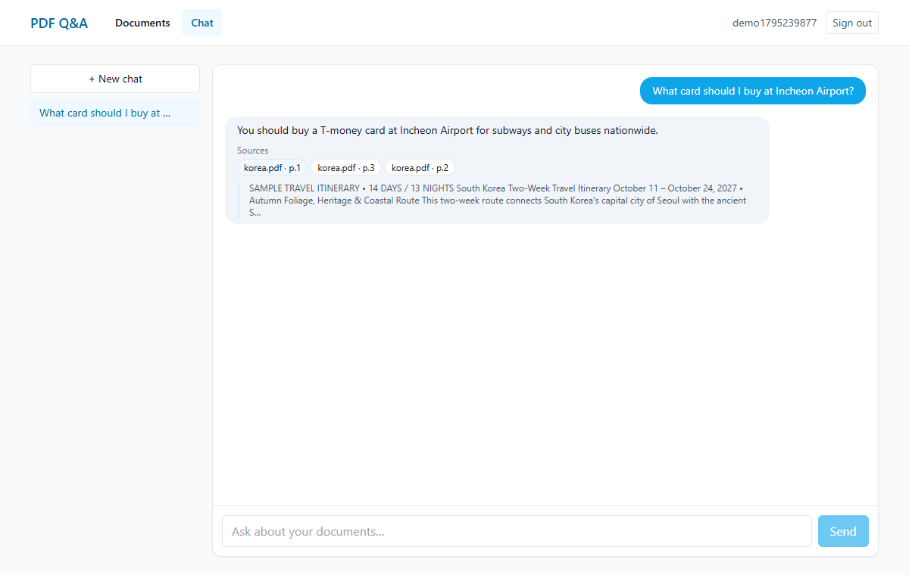
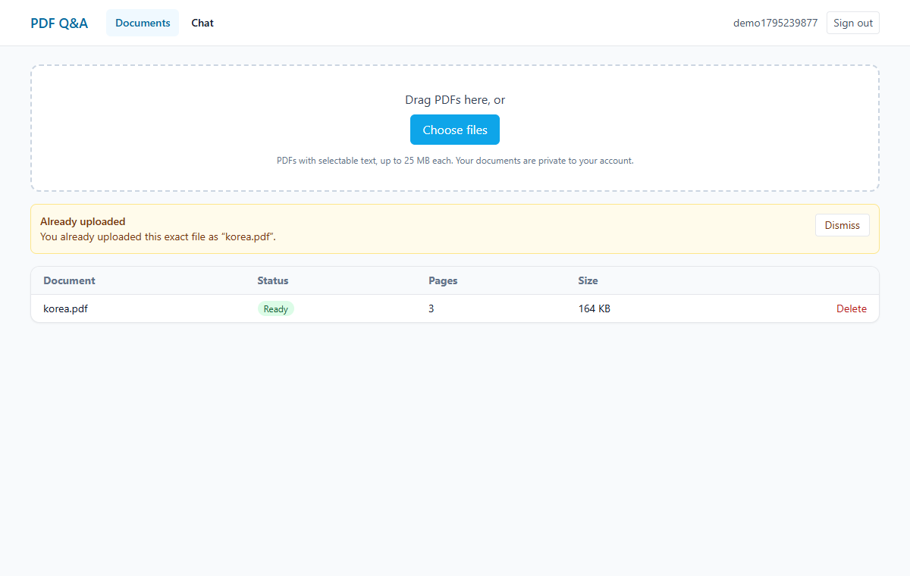
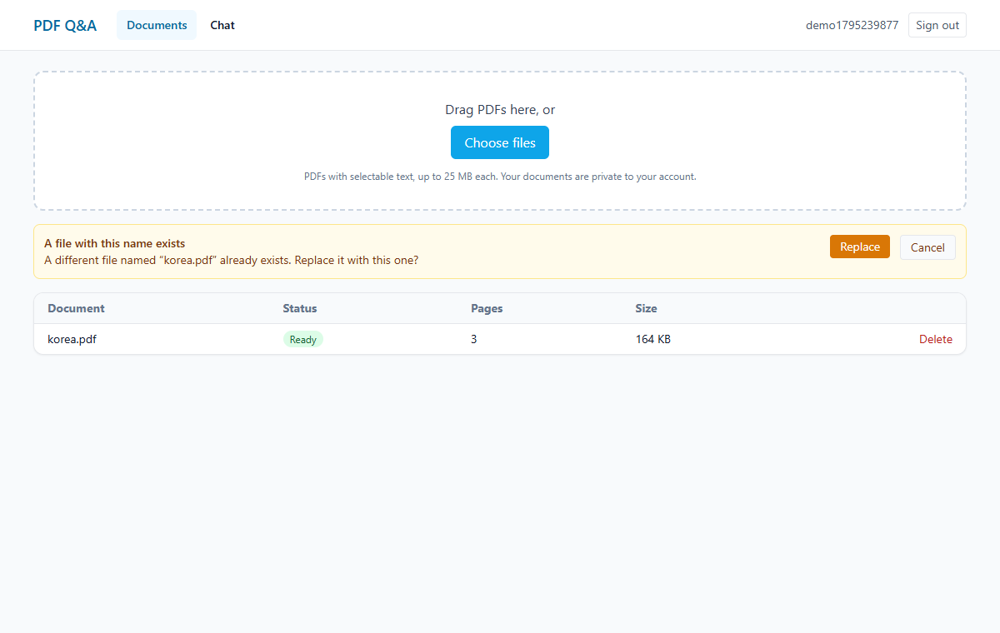

# PDF Q&A: chat with your documents

[](https://github.com/jammiguelyfish/pdf-qna-bot/actions/workflows/ci.yml)

**[Try the live demo](https://jammiguelyfish.github.io/pdf-qna-bot/)** (runs in your browser; see [the demo](#the-live-demo) for what is real)

A full-stack, fully local app for asking questions about your own PDFs. Sign up, upload documents, and chat with them. Answers come only from *your* documents, with the file and page they came from.

- **Backend:** Django + Django REST Framework, session auth, SQLite
- **Frontend:** React + TypeScript + Vite + Tailwind
- **RAG:** hybrid retrieval (embeddings fused with BM25 keyword search) over Chroma, answered by a local LLM through Ollama
- **Private by design:** every user gets their own vector collection, and both retrievers are scoped to it
- **No paid APIs, nothing leaves your machine**



## What you can do

- **Upload PDFs** by drag-and-drop. They are indexed in the background, with live status (queued, processing, ready, failed with a reason).
- **Get warned about duplicates.** Uploading the same file again, even under a different name, is refused with a message naming the existing copy. Uploading a *different* file with an existing name asks whether to replace it.
- **Chat** with your documents. Each answer lists its sources (file and page); click one to see the passage.
- **Keep conversations** and delete them, or delete a document and all its indexed content.
- Questions the documents can't answer get a fixed "I don't know" reply instead of a guess.





## Architecture

```
React SPA ──/api──▶ Django REST API ──▶ SQLite (users, documents, conversations)
 (Vite)               │
                      ├─ upload ──▶ file on disk + DB row (status: queued)
                      │                 │
                      │                 ▼
                      │          background worker thread
                      │          read PDF → chunk → embed → Chroma
                      │          collection "user_<id>"  (one per user)
                      │
                      └─ chat ───▶ hybrid retriever (dense + BM25, both limited to
                                   the user's ready documents) ──▶ Ollama LLM
                                   ──▶ answer + cited sources
```

The retrieval core (`ingestion.py`, `store.py`, `retrieval.py`, `qa.py`) has no Django dependency, so the original command-line tool still works and the web app reuses exactly the same code. Django's own apps are `accounts`, `documents` and `chat`.

## Quick start

You need Python 3.11+, Node 20+, and [Ollama](https://ollama.com/download) with a model pulled.

```bash
ollama pull mistral            # or any model; set LLM_MODEL to use another
```

**Backend**

```bash
python -m venv venv
venv\Scripts\activate          # macOS/Linux: source venv/bin/activate
pip install -r requirements.txt

# development mode (PowerShell: $env:DJANGO_DEBUG = "1")
export DJANGO_DEBUG=1
export LLM_MODEL=mistral       # the Ollama model that answers
python manage.py migrate
python manage.py runserver
```

**Frontend** (second terminal)

```bash
cd frontend
npm install
npm run dev                    # http://localhost:5173, proxies /api to Django
```

Open http://localhost:5173, create an account, upload a PDF, and ask a question. The first upload downloads the small embedding model (all-MiniLM-L6-v2) once.

> Outside development set `DJANGO_SECRET_KEY` (the server refuses to start without it) and `DJANGO_ALLOWED_HOSTS`. Set `ALLOW_REGISTRATION=0` to close sign-up.

## Deploy with Docker

One image holds the Django API and the built React app (served by WhiteNoise), so there is a single origin and nothing extra to host. Compose adds Ollama and downloads the model.

```bash
cp .env.example .env        # set DJANGO_SECRET_KEY (see the comment inside)
docker compose up --build   # first run downloads the model; open http://localhost:8000
```

- **Data** (database, uploaded PDFs, vector index) lives in the `app-data` volume, models in `ollama-models`. Both survive restarts and rebuilds.
- **Embedding model** is baked into the image, so the app container starts without internet.
- **Health check** at `/healthz/`; the container runs as a non-root user.
- **HTTPS:** put a TLS proxy (Caddy, nginx, a cloud load balancer) in front, then set `COOKIE_SECURE=1`, `TRUST_PROXY_SSL=1`, `DJANGO_ALLOWED_HOSTS` and `DJANGO_CSRF_TRUSTED_ORIGINS=https://your.host`. Also raise the proxy's upload limit to at least `MAX_UPLOAD_MB`.
- **One gunicorn worker** on purpose: indexing runs on an in-process thread. Requests are handled by 8 threads.
- Ollama runs on CPU in this compose file. For a GPU, add the `deploy.resources.reservations.devices` block to the `ollama` service.

## The live demo

The [GitHub Pages demo](https://jammiguelyfish.github.io/pdf-qna-bot/) is the same React app with a small backend written in TypeScript that runs in the browser, because a free static host cannot run Django or a language model.

| Real in the demo | Not in the demo |
| --- | --- |
| Upload checks: PDF header, SHA-256 duplicate detection, same-name warning and Replace | Reading PDFs you upload: they are checked but not searchable |
| Searching only the documents that are currently ready (delete or replace one and it drops out) | A language model: answers to the 5 suggested questions were **recorded** from the real pipeline; any other question returns the best-matching passages (BM25) |
| The three sample PDFs, chunked by the real ingestion code | Accounts and persistence (state resets on reload) |

The data is produced by `python scripts/export_demo.py --answers` (needs Ollama). A `VITE_DEMO=1` build swaps the API client for the in-browser backend (`frontend/src/demo/`); the workflow `.github/workflows/pages.yml` publishes it on every change to `frontend/`.

## How uploads behave

Ingestion is idempotent and restartable. Every stored chunk carries the file's content hash, how many chunks the file produced, and the embedding model used, so the index can always tell what is complete.

| Situation | What happens |
|---|---|
| The same document uploaded twice | Refused with `409 duplicate_content` and the name of the existing copy. Detected by SHA-256 of the file's bytes, so a renamed copy is caught too. |
| A different file with an existing name | `409 name_exists`; the UI asks. On "Replace" the old row, file and **all its embeddings are deleted** before the new one is indexed. |
| An existing document is edited | It has a new hash, so it is a different document: the replace flow above, or in the CLI an automatic update. |
| Outdated embeddings | Removed with the document, or by the CLI sync when a file disappears or changes. Chunk ids derive from the hash, so re-indexing the same content overwrites instead of duplicating. |
| Embedding fails halfway | Partly written chunks are removed again and the document is marked **failed** with a reason; nothing half-indexed stays behind. If the process is killed before cleanup, the document is picked up again after restart. A failed file can be re-uploaded. |
| One unreadable, scanned or password-protected PDF | Reported as failed with a clear message; it never blocks other files. |
| Deleted while still being indexed | The worker notices and removes the chunks it just wrote. |
| Embedding model changed | Chunks record their model, so the CLI re-embeds instead of mixing incompatible vectors. |

(Before this change the CLI deleted the whole index *before* embedding, so a failure left no database at all, and the same PDF under two names was indexed twice. Both were reproduced and are covered by tests now.)

## Privacy and isolation

- Each user's chunks live in a Chroma collection of their own (`user_<id>`). Dense search, the BM25 keyword index, deletion and retrieval all operate on that single collection.
- Retrieval is further restricted to the ids of the user's **ready** documents, so chunks left behind by a deleted or half-finished document can never surface (tested with a deliberately planted orphan chunk).
- Documents and conversations are looked up through the signed-in user, so another user's id returns `404`, never `403`, and cannot be read, deleted or written into.
- Files are stored under a random name in a per-user folder; the original filename is only a display label (path components and control characters are stripped).
- The keyword retriever is the easy place to leak: it is built from the collection's contents, not from a filtered query. It is built from the same user-scoped, ready-only set, and a test asks a question that only another user's document can answer.
- Passwords use Django's hashers and validators. Writes require a CSRF token; the session cookie is HttpOnly and SameSite=Lax (and Secure outside development).

## API

All endpoints require a session except `csrf`, `register` and `login`. Writes need the `X-CSRFToken` header (the client fetches the cookie from `/api/auth/csrf/`).

| Method and path | |
|---|---|
| `GET /api/auth/csrf/` | sets the CSRF cookie |
| `POST /api/auth/register/` `login/` `logout/`, `GET me/` | accounts (all under `/api/auth/`) |
| `GET /api/documents/` | your documents with status, pages, size |
| `POST /api/documents/` | multipart upload (`file`, optional `replace=true`); `201`, or `409` with `code` and the `existing` document |
| `GET` / `DELETE /api/documents/{id}/` | one document / delete it and its embeddings |
| `POST /api/chat/` | `{question, conversation?}` returns the conversation and the two new messages, with `sources` |
| `GET /api/conversations/`, `GET` / `DELETE /api/conversations/{id}/` | history |

Limits: PDFs only (checked by extension *and* the `%PDF-` header), 25 MB per file (`MAX_UPLOAD_MB`), questions up to 1000 characters, and per-user rate limits on chat (60/min) and uploads (60/hour). If Ollama is down, chat answers `503` with a readable message and saves nothing.

## Command-line tool

The original CLI still works, with the same fixes:

```bash
# put PDFs in data/pdfs/
python ingest.py        # makes the index match the folder
python qa.py            # interactive Q&A
```

`ingest.py` is now incremental: new files are added, edited files replace their old chunks, deleted files are removed, identical copies are skipped, an interrupted run is detected and finished, and a bad PDF is reported without stopping the rest. A second run with nothing changed does no embedding work.

```
Syncing './data/pdfs' with './chroma_db'...

  added: Philippines 21-Day Travel Itinerary.pdf, South Korea 14-Day Travel Itinerary.pdf, Tokyo 14-Day Travel Itinerary.pdf

Done. The index holds 30 searchable chunks.
```

## How retrieval works

`retrieval.py` builds a **hybrid retriever**: the question is matched against chunks by embedding similarity *and* by BM25 keyword score, and the two rankings are merged with reciprocal rank fusion. Month names are normalized (`January` becomes `jan`) so a question matches how dates are written in the PDF. The top chunks go to the local LLM with a strict prompt that forbids outside knowledge.

Why hybrid? Embeddings alone miss exact names and dates ("Busan", "January 15"). The [Evaluation](#evaluation) below measures how much, and where hybrid does and doesn't help.

## Evaluation

`evaluate.py` scores the bot against 27 hand-written questions over the three sample itineraries (`eval/questions.json`): 24 answerable, 6 of which are paraphrased so they share little wording with the PDF, and 3 whose answer is not in the documents. A unit test checks every expected fact against the PDFs, so the ground truth cannot drift.

```bash
python evaluate.py              # retrieval only, no LLM needed
python evaluate.py --answers    # also grade the answers (needs Ollama)
```

**Retrieval**: is the chunk containing the answer in the top 4? (Dense and BM25 gave identical results in 4 runs; the hybrid varies slightly from run to run, so its numbers are a range.)

| Retriever | Hit rate | MRR |
|---|---|---|
| dense (embeddings only) | 17/24 (71%) | 0.50 |
| BM25 (keywords only) | 23/24 (96%) | 0.78 |
| hybrid (what the bot uses) | 22-23/24 (92-96%) | 0.69-0.73 |

These numbers were re-checked after the ingestion rewrite and are unchanged (17/24, 23/24, 23/24), so the new pipeline chunks documents exactly as before.

**Answers** with `qwen2.5:1.5b-instruct` and the hybrid retriever: 20/24 answerable questions correct, 2/3 unanswerable questions refused. The full report is in [`eval/results.md`](eval/results.md).

What this shows, and what it doesn't:

- Embeddings alone are the weakest here: they miss exact dates and names, which is most of what people ask about an itinerary.
- Keyword search alone is as good as the hybrid, and ranks the answer higher. These documents are short and keyword-rich, so that is plausible. Hybrid is kept because it should be more robust when a question is worded differently from the document, but this question set cannot prove that, because BM25 also handled the paraphrased questions. The fusion weights were not tuned on this set.
- Of the 4 wrong answers to answerable questions, 2 were retrieval misses and 2 were the small model: it garbled a name ("Seoudong Yonggungsa") and answered "I don't know" although the right chunk was retrieved. One unanswerable question (which airline flies Jeju to Seoul) got an answer anyway. A larger model such as Mistral, the default, should do better but was not run here.
- Small-model answers are not stable: the order of the retrieved chunks changes between runs, and the 1.5B model answered the Busan question correctly in one run and incorrectly ("2 nights" instead of 3) in another while building the web app. The screenshots above use a question it answers reliably.
- 27 questions over 3 short PDFs is a sanity check, not a benchmark.

## Configuration

| Environment variable | Default | |
|---|---|---|
| `DJANGO_DEBUG` | `0` | `1` for development (also trusts the Vite dev origin for CSRF) |
| `DJANGO_SECRET_KEY` | none | required unless `DJANGO_DEBUG=1` |
| `DJANGO_ALLOWED_HOSTS` | `localhost,127.0.0.1` | comma-separated |
| `ALLOW_REGISTRATION` | `1` | `0` closes sign-up |
| `LLM_MODEL` / `OLLAMA_BASE_URL` | `mistral` / `http://localhost:11434` | which Ollama model answers |
| `TOP_K` | `4` | chunks passed to the model |
| `MAX_UPLOAD_MB` | `25` | per-file limit |
| `APP_VAR_DIR` | `./var` | database, uploads and vector index |

Chunking (1000 characters, 200 overlap) and the embedding model are constants in `ingestion.py` and `store.py`.

## Tests

```bash
python -m pytest                 # retrieval, ingestion lifecycle, evaluation
python manage.py test            # API: accounts, documents, chat, isolation
cd frontend && npm test          # React: duplicate warning, replace, chat
```

The ingestion and API tests run against a real Chroma index in a temporary directory with deterministic fake embeddings and a fake LLM, so they need no model download and run in CI. They cover duplicates, replace, update, removal, a failure halfway through writing, crash recovery, restart recovery, deleting during indexing, and cross-user isolation (documents, collections, chat sources, conversations, and the keyword index).

## Limitations

- **One server process.** Indexing runs on a single background thread, and unfinished documents are re-queued on the next request after a restart. For several workers or servers, use a real queue (Celery or RQ) and a server-based vector store.
- **Answers are single-turn.** Conversations are saved and shown, but earlier messages are not sent to the model, so a follow-up like "and the next day?" has no context.
- **No streaming.** The answer appears when the model finishes.
- **Text PDFs only.** Scanned PDFs are rejected with an explanation; there is no OCR.
- **The keyword index is rebuilt for every question** from the user's chunks. Fine for a few documents, wasteful for thousands.
- **Sign-in has no lockout** beyond password validation; chat and upload are rate limited but login attempts are not.
- The Docker setup is tested locally (image build, login, upload, chat), but not load-tested or deployed to a public host. TLS is left to a reverse proxy.
- **Answer quality depends on the model.** A 1.5B model is quick but sometimes wrong, as the evaluation shows.
- Uploads are limited by the Django process, not a reverse proxy; put one in front for real deployments.

## Project structure

```
manage.py, config/      Django project and settings
accounts/               sign-up, sign-in, CSRF
documents/              upload API, background indexing, per-user collections
chat/                   conversations, retrieval-augmented answers
frontend/               React app (documents page, chat page, auth)
frontend/src/demo/      in-browser backend for the GitHub Pages demo
scripts/                export_demo.py builds the demo data
ingestion.py            incremental, restartable PDF indexing (shared)
store.py                opening the Chroma index (shared)
retrieval.py            hybrid (embeddings + BM25) retriever (shared)
qa.py, ingest.py        command-line tools
evaluate.py, eval/      retrieval and answer evaluation
tests/                  core unit tests (also each app's tests.py)
data/pdfs/              three sample itineraries used in the evaluation
```

## License

Released under the [MIT License](LICENSE). The libraries it uses keep their own licenses.
